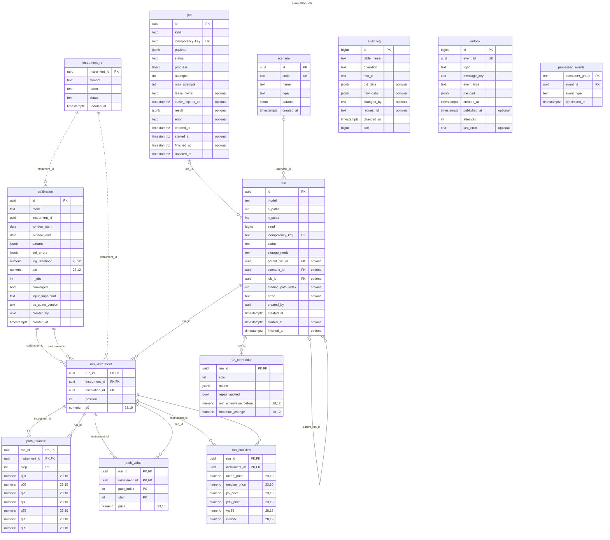

# simulation_db: entity-relationship diagram

Database of the Simulation service (M2), PostgreSQL 17.

**Generated, do not edit by hand.** Run `uv run python scripts/erd.py` in
`services/simulation` after any schema change; `tests/test_erd.py` fails while this file is
out of date. The source is the table definitions in
`services/simulation/src/qs_simulation/models.py` (checked against the migrations by
`tests/test_schema.py`) plus the job queue, outbox, processed-events and audit tables from
`libs/qs_template`.

How to read it:
- `PK` primary key, `FK` foreign key, `UK` unique. `"23,10"` is the numeric precision and
  scale: prices are exact decimals with 10 places, never floating point.
- `"optional"` columns may be empty; every other column is required.
- Solid lines are foreign keys. Dotted lines are references the schema deliberately does
  not enforce with a foreign key: `instrument_ref` is a cache of the market service's
  instruments for display, so nothing points at it by constraint.
- `run_instrument` points at `calibration (id, instrument_id)`, so a run cannot use another
  instrument's calibration, even through raw SQL.
- `path_value` holds every path of a small run; a larger run keeps its seed and
  `path_quantile` and regenerates a path on demand (ADR 03).

