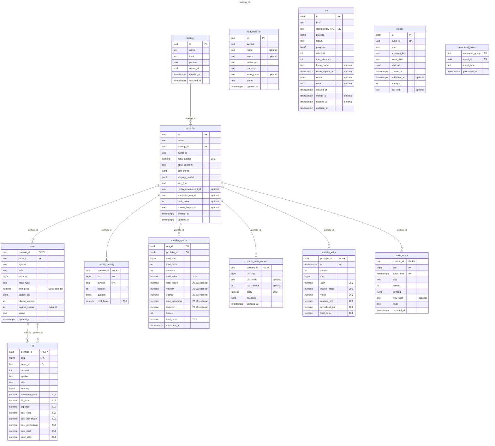

# trading_db: entity-relationship diagram

Database of the Trading service (Lane A), PostgreSQL 17 with TimescaleDB.

**Generated, do not edit by hand.** Run `uv run python scripts/erd.py` in
`services/trading` after any schema change; `tests/test_erd.py` fails while this file is
out of date. The source is the table definitions in
`services/trading/src/qs_trading/models.py` (checked against the migrations by the trading
schema tests) plus the job queue, outbox and processed-events tables from `libs/qs_template`.

How to read it:
- `PK` primary key, `FK` foreign key, `UK` unique. `"23,10"` is the numeric precision and
  scale: money and quantities are exact decimals, never floating point.
- `"optional"` columns may be empty; every other column is required.
- `trade_event` is the hash-chained event log of a run; holdings, values, metrics and the
  current state are projections rebuilt from it.
- `instrument_ref` is a cache of the market service's instruments, used for display.

